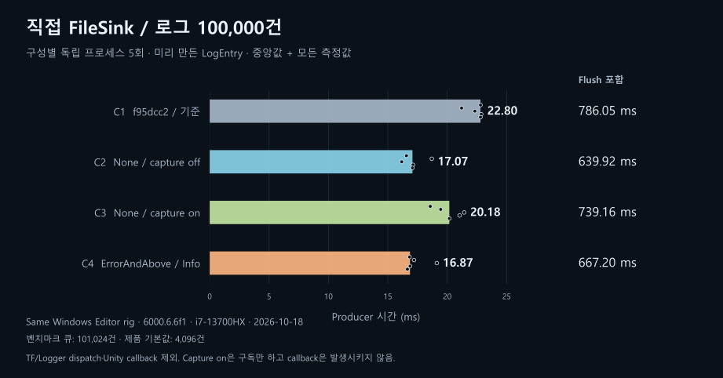
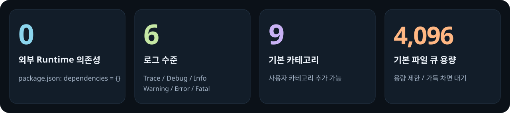
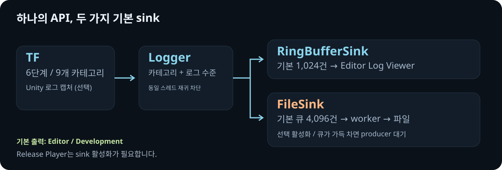
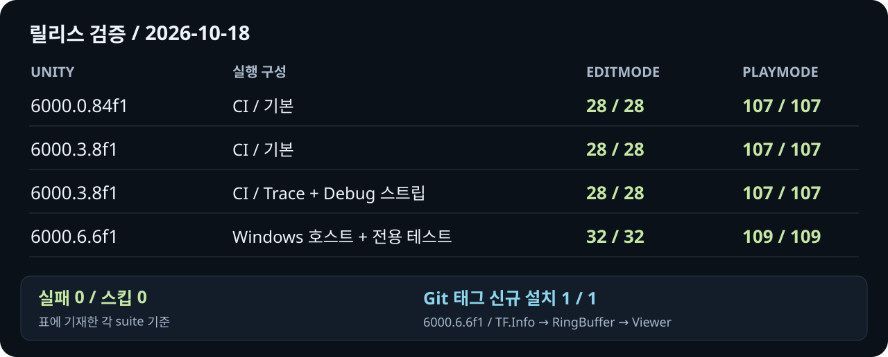

<p align="center">
  <a href="README.md">English</a> · <strong>한국어</strong> · <a href="Documentation~/TraceForge.md">API</a> · <a href="Documentation~/Migration.md">마이그레이션</a>
</p>


비동기 파일 출력, 카테고리 필터, Editor 로그 뷰어. **Unity 6000.0 이상 · .NET Standard 2.1 · MIT.**

## Unity 기본 로깅과 비교

<picture>
  <source media="(max-width: 640px)" srcset="Documentation~/Media/benchmark.ko.mobile.svg">
  
</picture>

같은 메시지 **100,000건**, 경로별 독립 실행 **5회**. **FileSink 하나만 직접 등록**한 구성의 호출 측 시간을 비교했습니다. 두 경로의 파일 형식과 내부 처리는 다릅니다.

TraceForge 호출+`Flush` 중앙값: **761.16ms**. Unity에는 동등한 Flush API가 없어 기록 완료 속도는 비교하지 않았습니다. Console UI·Player/mobile 성능도 이 수치에 포함되지 않습니다.

[측정 조건·모든 원시 결과·해석 범위](Documentation~/Benchmarks/2026-10-18-unity-logging-comparison.md).

## 빠른 시작

**1. 설치** — Package Manager → **Install package from git URL**:

```text
https://github.com/shinjh0380/trace-forge.git#v0.3.0
```

**2. 기록** — Editor와 Development 빌드에서는 초기화 코드 없이 호출합니다.

```csharp
using TraceForge;

TF.Info("Session started");
TF.Warning(Categories.Network, "Connection interrupted");

TF.SetCategoryVerbosity(Categories.Network, Verbosity.Debug);
if (TF.IsEnabled(Verbosity.Debug, Categories.Network))
    TF.Debug(Categories.Network, $"Frame {UnityEngine.Time.frameCount}");
```

**3. 확인** — **Window → TraceForge → Log Viewer**.

파일은 **Project Settings → TraceForge**에서 **File Sink**를 켭니다. 기본 경로: `Application.persistentDataPath/traceforge.log`. Release Player에는 sink를 활성화해야 합니다. 스레드를 사용하는 `FileSink`는 WebGL을 지원하지 않습니다.

문자열 보간이나 비용이 큰 인수는 **먼저 `IsEnabled`로 확인**합니다. 스트립 심볼이 메서드 본문을 제거해도 C# 인수 평가는 남습니다. [스트리핑·전체 API](Documentation~/TraceForge.md).

## 숫자로 보는 구성

<picture>
  <source media="(max-width: 640px)" srcset="Documentation~/Media/facts.ko.mobile.svg">
  
</picture>

[출처: 패키지 메타데이터와 Runtime 기본값](Documentation~/Media/README.md#sources).

## 로그 전달 구조

<picture>
  <source media="(max-width: 640px)" srcset="Documentation~/Media/pipeline.ko.mobile.svg">
  
</picture>

## 검증한 구성

<picture>
  <source media="(max-width: 640px)" srcset="Documentation~/Media/validation.ko.mobile.svg">
  
</picture>

[CI 결과](https://github.com/shinjh0380/trace-forge/actions/runs/39113329138) · [릴리스 근거](https://github.com/shinjh0380/trace-forge/blob/800fe50095c74448e12ed097842659b4324359e6/Documentation~/Releases/0.3.0.md) · [시각 자료 출처](Documentation~/Media/README.md)

---

[API](Documentation~/TraceForge.md) · [마이그레이션](Documentation~/Migration.md) · [기본 예제](Samples~/BasicUsage) · [변경 기록](CHANGELOG.md) · [이슈](https://github.com/shinjh0380/trace-forge/issues) · [MIT License](LICENSE.md)
