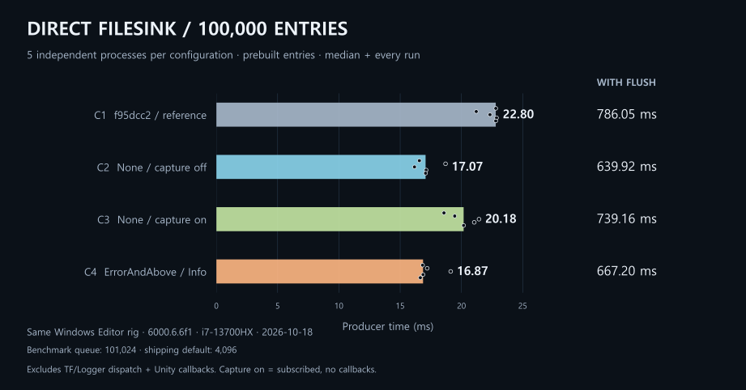
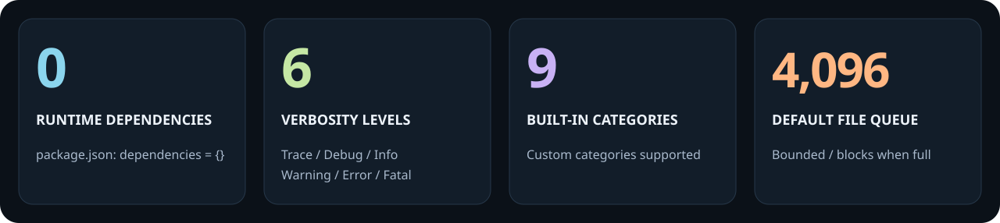
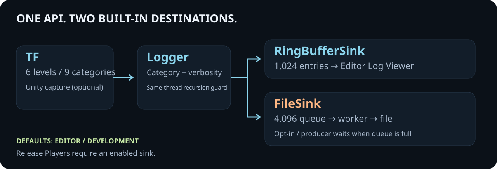
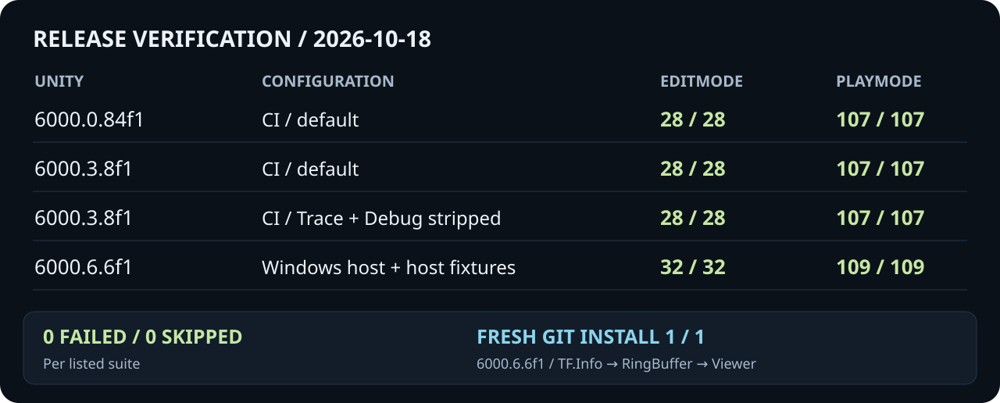

<p align="center">
  <strong>English</strong> · <a href="README.ko.md">한국어</a> · <a href="Documentation~/TraceForge.md">API</a> · <a href="Documentation~/Migration.md">Migration</a>
</p>


Asynchronous files, category filters, and an Editor log viewer. **Unity 6000.0+ · .NET Standard 2.1 · MIT.**

## Compared with Unity logging

<picture>
  <source media="(max-width: 640px)" srcset="Documentation~/Media/benchmark.en.mobile.svg">
  
</picture>

**100,000 identical messages**, **5 independent runs** per route. Caller time uses **one manually registered FileSink**. The two routes have different file formats and internal work.

TraceForge calls + `Flush` median: **761.16ms**. Unity has no equivalent Flush API, so completion speed is not compared. These are not Console UI or Player/mobile measurements.

[Method, every raw result, and scope](Documentation~/Benchmarks/2026-10-18-unity-logging-comparison.md).

## Quick start

**1. Install** — Package Manager → **Install package from git URL**:

```text
https://github.com/shinjh0380/trace-forge.git#v0.3.0
```

**2. Log** — no initialization code in the Editor or Development builds:

```csharp
using TraceForge;

TF.Info("Session started");
TF.Warning(Categories.Network, "Connection interrupted");

TF.SetCategoryVerbosity(Categories.Network, Verbosity.Debug);
if (TF.IsEnabled(Verbosity.Debug, Categories.Network))
    TF.Debug(Categories.Network, $"Frame {UnityEngine.Time.frameCount}");
```

**3. Inspect** — **Window → TraceForge → Log Viewer**.

For files, enable **File Sink** in **Project Settings → TraceForge**. Default output: `Application.persistentDataPath/traceforge.log`. Release Players need an enabled sink. Threaded `FileSink` is unsupported on WebGL.

Use `IsEnabled` **before** interpolation or expensive arguments. Strip symbols remove method bodies; C# still evaluates call arguments. [Stripping and full API](Documentation~/TraceForge.md).

## By the numbers

<picture>
  <source media="(max-width: 640px)" srcset="Documentation~/Media/facts.en.mobile.svg">
  
</picture>

[Sources: package metadata and runtime defaults](Documentation~/Media/README.md#sources).

## Where logs go

<picture>
  <source media="(max-width: 640px)" srcset="Documentation~/Media/pipeline.en.mobile.svg">
  
</picture>

## Verified configurations

<picture>
  <source media="(max-width: 640px)" srcset="Documentation~/Media/validation.en.mobile.svg">
  
</picture>

[CI results](https://github.com/shinjh0380/trace-forge/actions/runs/39113329138) · [Release evidence](https://github.com/shinjh0380/trace-forge/blob/800fe50095c74448e12ed097842659b4324359e6/Documentation~/Releases/0.3.0.md) · [Visual data sources](Documentation~/Media/README.md)

---

[API](Documentation~/TraceForge.md) · [Migration](Documentation~/Migration.md) · [Basic Usage](Samples~/BasicUsage) · [Changelog](CHANGELOG.md) · [Issues](https://github.com/shinjh0380/trace-forge/issues) · [MIT License](LICENSE.md)
